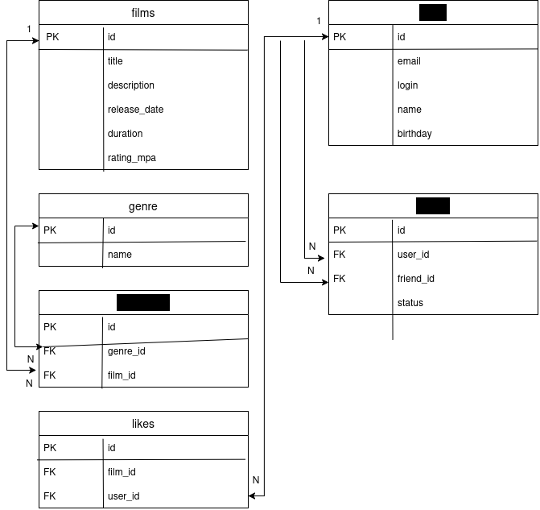

# java-filmorate

### _ER-диаграмма БД_

### Лента событий

`GET /users/{id}/feed` возвращает события самого пользователя: `FRIEND` и `LIKE`
с операциями `ADD`/`REMOVE`, `REVIEW` с операциями `ADD`/`UPDATE`/`REMOVE`.
Сначала возвращаются последние события; при одинаковом времени — события с большим `eventId`.
`timestamp` — время в миллисекундах Unix. `entityId` — ID друга, фильма или отзыва
соответственно. Для существующего пользователя без событий возвращается `[]`, для
несуществующего — `404`, для неположительного ID — `400`.

Повторное добавление существующего друга или лайка и удаление отсутствующей связи
не создают событий. Голоса за отзывы не попадают в ленту. Изменение данных и запись
события выполняются в одной транзакции.
